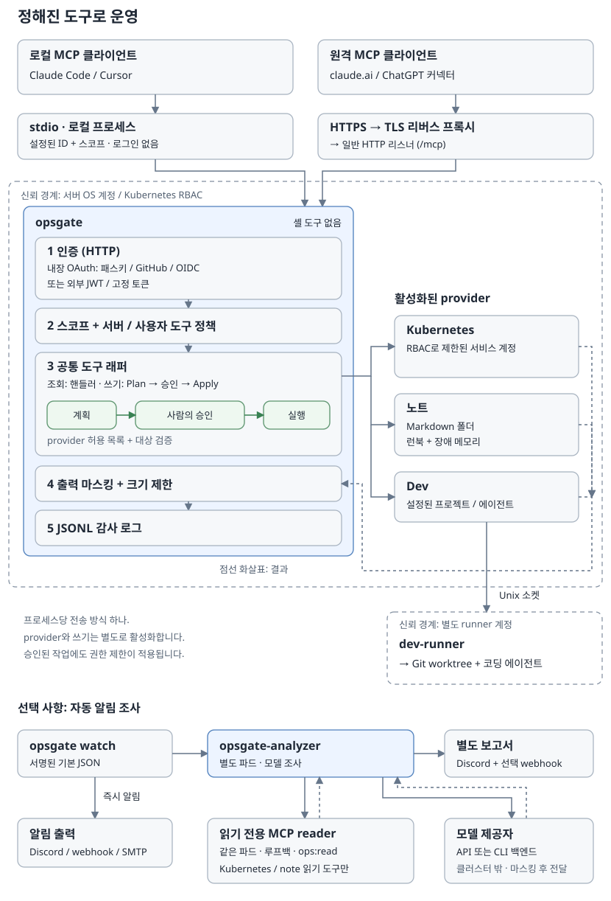
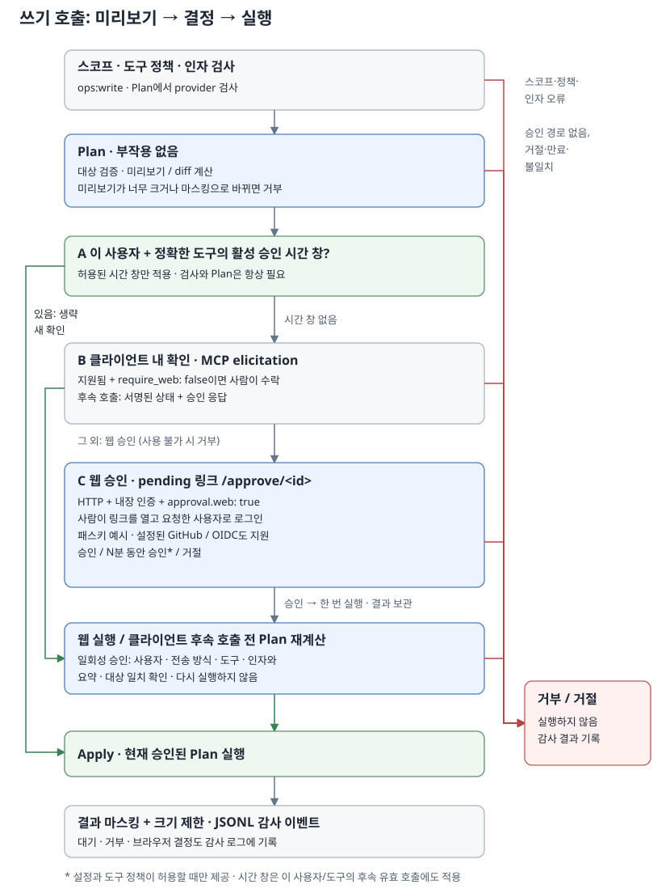
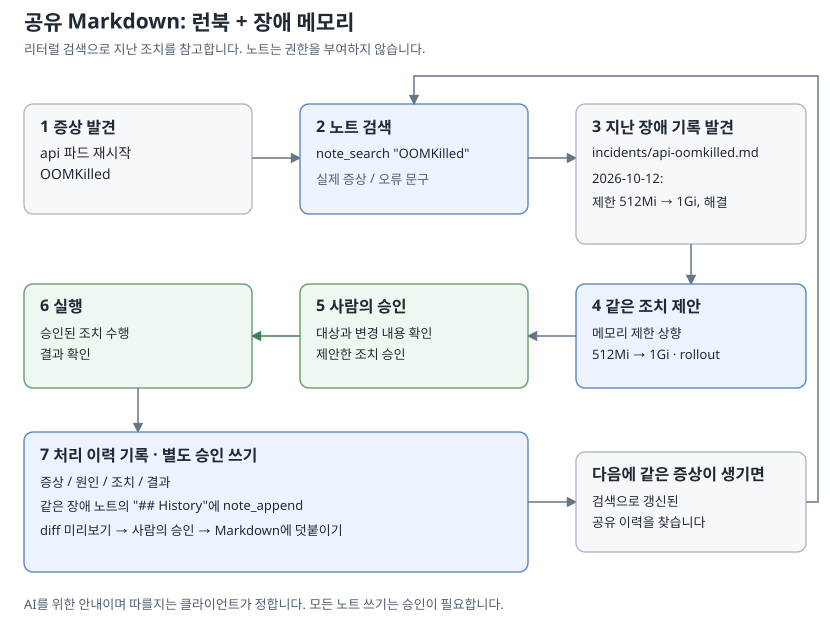

<p align="center"></p>

# opsgate

[English](README.md)

**셸을 열어 주지 않고도 AI 어시스턴트의 도움을 받아 클러스터를 운영할 수 있습니다.**

opsgate는 Go로 작성한 오픈 소스 MCP 서버입니다. Claude, ChatGPT, Claude Code,
Cursor 같은 클라이언트에 Kubernetes를 운영하는 정해진 도구를
제공합니다. 정책을 명시하고 감사 로그를 남기며, 변경 작업에는 사람이 승인한 범위를 적용합니다.

> **상태:** 첫 공개 릴리스에 필요한 기능을 구현했습니다. 변경 작업에는 사용자 권한 검사,
> 허용 대상 제한, 사람의 승인이 적용됩니다. 조회 범위 제한과 출력 마스킹으로 민감 정보
> 노출을 줄입니다. 외부 보안 검토는 아직 받지 않았으며, 보호 범위와 남아 있는 한계는
> [보안 정책](docs/ko/security.md)에 설명합니다.


## 왜 opsgate인가


### 임의 명령을 실행하지 않습니다

목적이 정해진 도구만 있습니다. 셸 도구도,
Kubernetes Secret 조회 도구도 없습니다.

### 모든 기능이 꺼진 상태로 시작합니다

provider, 쓰기 작업, 허용 목록은 설정에서
직접 켜기 전까지 동작하지 않습니다.

### 변경에는 사람의 승인이 필요합니다

쓰기 도구는 먼저 바꿀 내용을 정확히 계산하고,
웹 승인을 사용할 수 있으면 기본적으로 브라우저에서 사람의 승인을 받습니다.
선택 기능인 승인 시간 창은 아래에서 설명합니다.

### 원격 접속은 인증을 거칩니다

내장 OAuth 2.1 서버가 claude.ai와 ChatGPT
커넥터를 지원합니다. 패스키, GitHub, OIDC(Google 포함)로 로그인하거나 외부 JWT를
검증하도록 설정할 수 있습니다.

### 조회 결과는 분석 자료로 취급합니다

AI 클라이언트에는 로그나 조회 결과 안의 지시문을
따르지 않도록 안내합니다. 반환 결과에는 민감 정보 마스킹과 길이 제한을 적용합니다.
누가 어떤 도구를 호출했고 어떻게 처리됐는지는 한 줄에 JSON 하나씩 감사 로그에 기록합니다.

### 지난 조치를 기록하고 다시 참고합니다

선택 기능인 note provider가 런북과 지난 장애 기록을
일반 Markdown으로 보관합니다. AI에 과거 기록을 먼저 참고하고,
이번 조치를 기록할지 사용자에게 제안하도록 안내합니다. [노트](docs/ko/notes.md)를 참고하세요.


## 할 수 있는 일

각 기능 묶음을 provider라고 부르며, 필요한 것만 설정에서 켤 수 있습니다.

| 기능(provider) | 조회 도구 | 변경 도구(승인 필요) |
| --- | --- | --- |
| Kubernetes | 개요, 목록, 상세, 이벤트, 파드 로그 | 워크로드 재시작, 실행할 파드 수 조정, 파드 삭제 |
| 노트: 런북과 메모리, Markdown 폴더 또는 Obsidian 볼트 *(실험적)* | 검색, 읽기, 목록, 최근 노트, 링크, 태그 | 작성, 내용 추가, 내용 수정, 휴지통으로 이동 |
| Dev *(실험적)* | 프로젝트, 작업 상태, 로그, diff, 목록 | Git worktree에서 코딩 에이전트(Codex, Claude) 실행 |

스코프는 사용자가 opsgate를 통해 수행할 수 있는 작업의 종류입니다. `ops:read`는 조회, `ops:write`는
운영 대상과 노트 변경, `dev:run`은 코딩 에이전트 실행에 사용합니다. 허용 목록은 접근할
도구나 변경할 Kubernetes 대상 등을 설정으로 제한하는 장치입니다. 스코프가 있어도
설정에서 허용하지 않은 작업은 실행할 수 없습니다.

노트 작성은 설정한 노트 폴더 안에서만 가능합니다. 일반 파일을 서버의 임의 경로에
만들거나 Kubernetes의 CPU·메모리 requests·limits를 변경하는 도구는 없습니다.
requests·limits 설정값은 Kubernetes 상세 조회로 확인할 수 있습니다.
전체 인자와 제한은 [도구 문서](docs/ko/tools.md)를 참고하세요.


## 동작 방식



AI 클라이언트가 조회 결과를 분석하고 다음 작업을 선택합니다. opsgate 자체는 AI 모델을
실행하거나 호출하지 않으며, 요청받은 도구의 권한과 대상을 검사하고 실행합니다.

Kubernetes 도구는 kubeconfig의 접속 정보나 클러스터 내부 인증으로 Kubernetes API에
접속합니다. 따라서 로컬 PC에서 실행해도 네트워크 연결과 접근 권한이 있으면 원격
클러스터를 조회할 수 있습니다.

클라이언트는 로컬 stdio(클라이언트가 opsgate를 실행하고 표준 입출력으로 통신하는 방식)
또는 TLS 리버스 프록시를 거치는 HTTPS로 연결합니다.
opsgate는 신원과 정책을 확인하고, 쓰기 작업을 계획한 뒤 승인을 받아 실행합니다.
이후 출력을 처리하고 감사 로그를 남깁니다.
실제 접근 범위는 OS 계정과 Kubernetes RBAC가 제한합니다.

자세한 내용: [구조](docs/ko/architecture.md) · [승인](docs/ko/approval.md) ·
[인증](docs/ko/authentication.md)

### 승인 흐름

변경 도구는 먼저 대상과 변경 내용을 확인해 실행 계획을 만듭니다. 웹 승인을 사용할 수
있으면 기본적으로 사용자가 웹 승인 페이지에서 내용을 확인하고 승인해야 실행합니다.
`approval.require_web: false`를 명시하면 클라이언트 내 확인을 허용하며, 침해된 클라이언트가
자기 쓰기를 스스로 승인할 수 있습니다. external/static 인증과 stdio는 웹 채널이 없어
클라이언트 내 확인을 유지합니다. 모드 파일도 `require_web`을 생략하면 `-transport stdio`에서
클라이언트 내 확인을 허용하지만, 명시적 `true`는 stdio 쓰기를 거부합니다.
일회성 승인은 해당 인자와 계획에만 유효합니다.

선택적으로 승인 시간 창을 설정하면, 사용자가 특정 도구를 일정 시간 동안 승인할 수
있습니다. 그동안 같은 사용자의 해당 도구 호출은 대상이나 인자가 달라도 추가 승인 요청을
생략할 수 있습니다. 권한과 허용 대상 검사는 매번 수행하며, 기본값은 꺼짐입니다.



### 노트: 런북과 메모리

note provider를 활성화하면 AI에 조치 전 과거 기록을 검색하고, 처리 후 기록을 남길지
제안하도록 안내합니다. 실제 검색과 제안 여부는 AI 클라이언트가 결정하며, 자동 실행을
보장하지는 않습니다. 노트 변경에도 승인이 적용됩니다. 저장한 기록은 다음 조사에서
다시 검색해 참고할 수 있습니다.
[노트](docs/ko/notes.md)를 참고하세요.




## 빠른 시작: 로컬(stdio)

Go 1.26 이상으로 빌드하세요.

```sh
go install github.com/gkdis6/opsgate/cmd/opsgate@latest   # 또는: make build
```

현재 kubeconfig를 사용하는 설정 파일을 저장하세요. 아래 예제에서는 `/path/opsgate.yaml`을 사용합니다.

```yaml
stdio:
  scopes: [ops:read]
providers:
  kubernetes:
    enabled: true
    namespaces: [default]
```

Claude Code에 등록하세요. 경로는 절대 경로로 쓰세요.

```sh
claude mcp add opsgate -- /path/to/opsgate -config /path/opsgate.yaml
```

stdio는 실행한 계정의 권한으로 동작하므로 관리자 권한이 없는 일반 계정으로 실행하세요. 다른
클라이언트는 [클라이언트 설정](docs/ko/clients.md)을 참고하세요.


## 빠른 시작: 원격(HTTP + 패스키)

패스키는 별도의 ID 제공자가 필요 없습니다. Face ID, Touch ID, Windows Hello,
휴대폰, 보안 키로 로그인할 수 있습니다.

`opsgate init`이 공개 URL, 로그인할 사람, 네임스페이스를 묻고 짧은 설정 파일을 만듭니다.

```sh
opsgate init            # opsgate.yaml을 만듭니다. 플래그로 미리 답할 수 있습니다(-h 참고)
```

```yaml
mode: kubernetes
http:
  public_url: "https://mcp.example.com"
auth:
  builtin:
    users:
      - subject: "passkey:alice"
        scopes: [ops:read]
    admins: ["passkey:alice"]
    allowed_redirect_hosts: [claude.ai, chatgpt.com, localhost]
    unknown_redirect_hosts: approve
providers:
  kubernetes:
    namespaces: ["*"]
    deny_namespaces: ["kube-system", "kube-public", "kube-node-lease", "opsgate"]
    allow_logs: true
```

나머지는 모드가 채웁니다. HTTP는 `0.0.0.0:8787`에서
받고, 내장 패스키 로그인을 쓰며, 상태를 `/var/lib/opsgate`에 두고, 브라우저 승인
링크와 파드의 ServiceAccount를 사용합니다. 적용되는 값 전체는
`opsgate config show -config opsgate.yaml`로 볼 수 있습니다.

설정 파일을 `deploy/kubernetes/opsgate-deployment.yaml`의 `opsgate` ConfigMap에 넣고 적용하세요. 매니페스트의 기본 예제는 Google 로그인이며, 패스키 설정으로 바꿔도 현재 매니페스트의 필수 `opsgate-upstream` Secret 마운트는 남아 있습니다. Secret 준비, 이미지 검증, RBAC과 probe 설정은 [배포](docs/ko/deploy.md)를 따르세요.

```sh
kubectl apply -f deploy/kubernetes/opsgate-deployment.yaml
```

`opsgate -h`는 명령과 플래그 목록을, `opsgate help <명령>`은 해당 명령의 도움말을 보여 줍니다. `opsgate version` 또는 `-version`은 빌드 버전을 출력합니다. 도움말과 명령 성공은 종료 코드 0, 잘못된 명령·플래그나 불필요한 인자는 설정을 읽기 전에 2, 실행 중 오류는 1을 반환합니다. 도움말은 stdout, 오류는 stderr로 출력합니다.

1. 처음 시작하면 패스키가 없는 사용자마다 일회용 등록 링크(24시간 유효)가 로그에
   남습니다. 링크를 열고 **Create passkey**를 누르세요. 링크를 새로 만들려면
   `kubectl -n opsgate exec deploy/opsgate -- /opsgate passkey invite -config /etc/opsgate/opsgate.yaml -subject passkey:alice`를 실행하세요.
2. 앞단에 `Host` 헤더를 그대로 전달하는 TLS ingress나 리버스 프록시를 두세요. 공개 호스트는
   `public_url`과 같아야 하며, 다른 호스트로 온 요청은 421로 거부됩니다.
3. 클라이언트를 `https://mcp.example.com/mcp`에 연결하세요. 예:
   `claude mcp add --transport http opsgate https://mcp.example.com/mcp`.
   claude.ai나 ChatGPT에서는 커넥터로 추가하세요.

생성된 파일은 클라이언트 리다이렉트 호스트(`allowed_redirect_hosts`)를 이미
제한합니다. 외부에 공개하기 전에 확인하세요. GitHub, Google 등 다른 로그인 방식은
[인증 문서](docs/ko/authentication.md)에, 프록시 경로·릴리스 검증은
[배포 문서](docs/ko/deploy.md)에 있습니다.


## Watch 알림

MCP 서버와 함께 `opsgate watch`를 실행하면 Kubernetes의 문제와 변경 알림을
받을 수 있습니다. Kubernetes API를 감시하고 Discord, 커스텀 JSON 웹훅,
SMTP 이메일로 직접 전송하므로 n8n은 선택 사항입니다. 받은 알림을 MCP
클라이언트에 붙여넣으면 opsgate 조회 도구로 해당 리소스의 원인을 조사할 수 있습니다.

Kubernetes provider가 켜진 설정에 다음 내용을 추가하세요.

```yaml
watch:
  outputs:
    - name: discord
      type: discord
      url_file: /etc/opsgate/discord-webhook-url
    - name: custom
      type: webhook
      url: https://alerts.example.com/ingest
      header_files:
        Authorization: /etc/opsgate/alerts-authorization
      body_template: |
        {"message": {{json .Text}}, "sent_at": {{json .SentAt}}, "alerts": {{json .Alerts}}}
```

필요한 전송 대상만 남기면 됩니다. Discord 채널에서 만든 수신 웹훅 URL을
`url_file`에 저장하고, 인증 헤더 파일에는 `Bearer TOKEN`처럼 전체 값을 넣으세요.
파일은 시작할 때 읽으므로 변경 후 watch를 재시작해야 합니다. Kubernetes에서는
Secret을 파일로 마운트해 사용하세요.

```sh
opsgate watch -config opsgate.yaml
```

각 대상은 별도 큐·쿨다운·재시도를 사용합니다. Discord 메시지에는 발생 시각(UTC),
클러스터, namespace/리소스, 오류 이유와 요약이 포함되며, 긴 배치는 Discord 제한에
맞춰 잘림을 표시합니다. 커스텀 템플릿은 `json` 함수로 값을 안전하게 인코딩하고
유효한 JSON을 만들어야 합니다. 기존 `watch.webhook_url`과 `watch.email`도
새 전송 대상과 함께 사용할 수 있습니다. 전송 제한, HMAC 서명과 전체 설정은
[watch 알림 문서](docs/ko/watch.md)를 참고하세요.


## 보안 모델 요약

- 인스턴스 하나가 신뢰 그룹 하나입니다. `ops:read`는 켜진 provider 전체에 적용됩니다.
  운영 서버, 개인 노트, 코딩 에이전트처럼 신뢰 수준이 다른 대상은 인스턴스와 OS
  계정을 나누세요.
- 스코프, 서버 도구 정책, 사용자별 도구 목록, provider 허용 목록을 차례로 검사하고,
  마지막으로 OS 권한과 Kubernetes RBAC가 접근을 제한합니다.
- HTTP에서는 `approval.web`이 켜져 있으면 기본적으로 브라우저 승인을 요구합니다.
  `approval.require_web: false`를 명시하면 클라이언트 내 확인을 허용하며, 침해된 클라이언트가
  자기 쓰기를 스스로 승인할 수 있습니다. HTTP 시작 시 경고를 남깁니다.

자세한 내용: [보안 정책](docs/ko/security.md)


## 문서

| 문서 | 내용 |
| --- | --- |
| [구조](docs/ko/architecture.md) | 요청 흐름, 패키지, 설계 원칙 |
| [인증](docs/ko/authentication.md) | 패스키, GitHub, OIDC, 외부 JWT, 고정 토큰, stdio |
| [승인](docs/ko/approval.md) | 계획과 실행, 승인 경로, 승인 시간 창 |
| [클라이언트 설정](docs/ko/clients.md) | Claude Code, Claude Desktop, claude.ai, ChatGPT, Cursor |
| [설정](docs/ko/configuration.md) | 모든 설정 키와 기본값, 감사 로그 형식 |
| [도구](docs/ko/tools.md) | 도구 인자, 제한, 마스킹 |
| [노트](docs/ko/notes.md) | Markdown 폴더에 런북과 장애 기록 남기기 |
| [배포](docs/ko/deploy.md) | 릴리스 검증, Kubernetes, 리버스 프록시 |
| [Dev provider](docs/ko/dev.md) | 별도 runner로 코딩 에이전트 실행 |
| [Watch 알림](docs/ko/watch.md) | 별도 `opsgate watch` 프로세스로 Kubernetes 알림을 Discord·커스텀 JSON 웹훅·이메일로 전송 |
| [로드맵](docs/ko/roadmap.md) | 완료한 기능과 앞으로의 계획 |


## 기여와 라이선스

[CONTRIBUTING.md](CONTRIBUTING.md), [행동 강령](CODE_OF_CONDUCT.md),
[변경 이력](CHANGELOG.md)을 참고하세요. 라이선스는 [Apache-2.0](LICENSE)이며,
저작권은 2026 The opsgate Authors에 있습니다.
