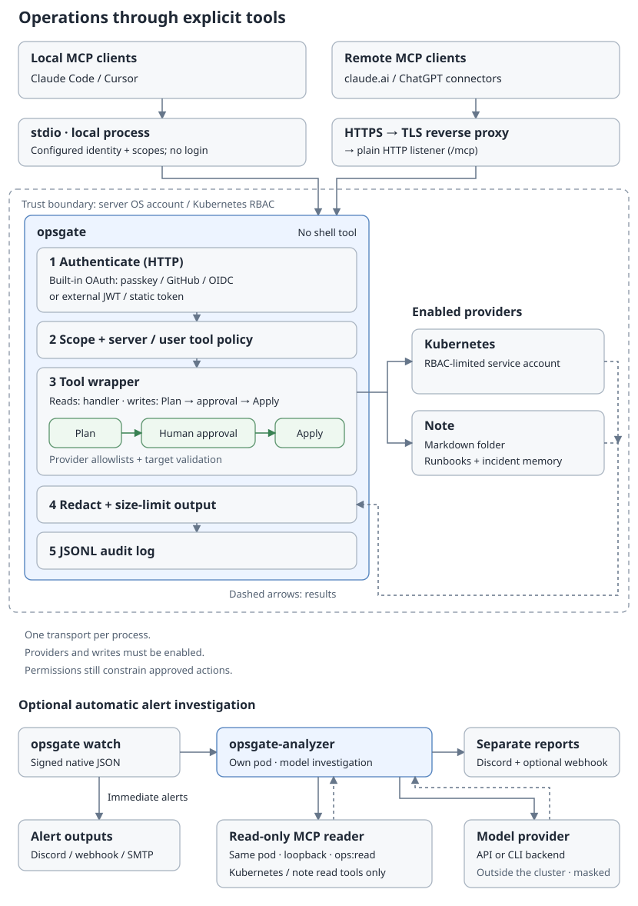
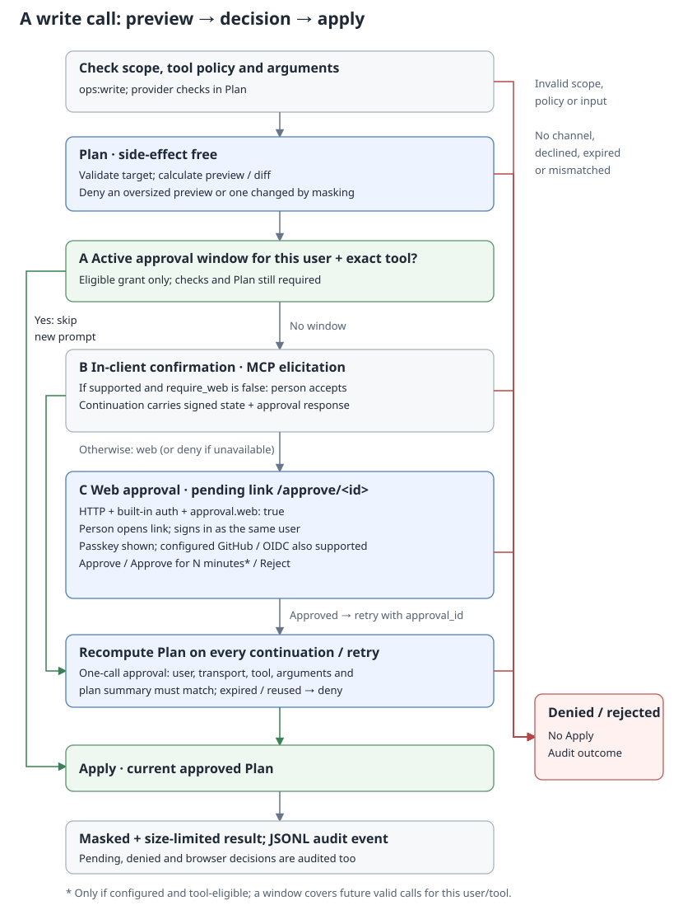
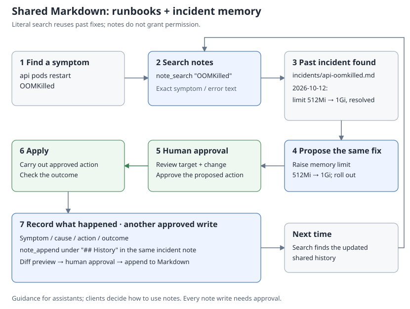

<p align="center"></p>

# opsgate

[한국어](README.ko.md)

**Know when your server breaks, and fix it from wherever you are, without handing AI a shell.**

opsgate is an open-source operations gate, written in Go, for people who run
servers on their own. It watches Kubernetes, alerts you when something fails,
and lets you approve a fix with a passkey from your phone or computer. Once the
service is back, AI clients such as Claude, ChatGPT, Claude Code and Cursor
investigate the cause through opsgate's MCP server: a fixed set of tools with
explicit policy, human-approved changes and an audit log.

> **Status:** early release; notes, watch and the analyzer are
> experimental. Changes require user authorization, allowed targets and human approval. Read restrictions
> and output redaction reduce sensitive data exposure. Third-party security review
> is pending; the [security policy](SECURITY.md) explains the protections and
> remaining limitations.


## The problem

Running a server alone usually leaves two gaps:

- **You find out late.** Without proper alerting, you hear about an outage from
  users, or stumble on it yourself.
- **You know the fix but cannot reach the server.** A phone SSH app works, but
  typing commands on a phone in the middle of an outage is slow and error-prone.

Giving an AI assistant a shell would close the second gap and open a worse one:
a single wrong or irreversible command. opsgate closes both gaps and keeps every
change in front of a person.


## How it handles an incident

1. **Know first.** `opsgate watch` follows the Kubernetes API and sends alerts to
   Discord, webhooks or email as soon as something fails. See [watch alerts](#watch-alerts).
2. **Stabilize from anywhere.** An alert, or the analyzer's report on it, can
   carry a ready-made action: restarting a workload or restoring the last working
   image. Opening it shows a fresh plan after sign-in, and approving runs it. A
   phone browser and a passkey are enough.
3. **Then find the cause.** With the service back, ask your AI client to
   investigate through opsgate's read tools, or let the optional
   [analyzer](docs/analyzer.md) make a first pass.
4. **Remember it.** The optional note provider keeps runbooks and past incidents
   in plain Markdown, and assistants are instructed to check them first and offer
   to record the outcome. See [notes](docs/notes.md).


## Design principles


### No arbitrary commands

Only purpose-built tools exist. There is no shell
tool and no Kubernetes Secrets tool.

### Everything starts off

Providers, write actions and allowlists are disabled
until you enable them in configuration.

### Changes need a person

Write tools first plan the exact change, then wait
for human approval in the browser by default when web approval is available.
Optional approval windows are explained below.

### Nothing permanently deletes your data

Note removal moves files to `.trash`. Pod deletion is the only delete action; it
needs its own allowlist and approval, and the plan warns when no controller will
recreate the pod.

### Remote access is authenticated

A builtin OAuth 2.1 server works with
claude.ai and ChatGPT connectors. Sign in with passkeys, GitHub or OIDC
(Google included), or verify external JWTs.

### Results are data for analysis

AI clients are instructed not to follow
instructions embedded in logs or other results. Returned results are redacted
and size-limited. The audit log records who called each tool and its outcome,
with one JSON object per line.


## Where it is heading

These are planned, not implemented. Order and details are in the
[roadmap](docs/roadmap.md).

- **An approval inbox with Web Push.** Approval requests reach your phone or
  computer, whichever is at hand, and approving runs the action right away. Chat
  and messenger alerts will only link to the inbox, so passkeys always work.
- **The same path for MCP clients.** A change requested in a chat goes to the
  inbox and runs on approval, without returning to the chat to say so.
- **More choices per failure.** Each failure state offers the actions that fit
  it, including ones the analyzer proposes. Every button comes from a fixed
  catalog of allowlisted actions that never delete data, and shows whether a
  rule or the AI suggested it.
- **Alert groups by namespace,** each with its own channels, level and batching.
- **An optional host provider** for systemd units and Docker or Compose
  containers on servers without Kubernetes. It stays off unless you enable it.
- **Undo buttons** for actions that can be reversed.


## What it can do

Providers are groups of tools; enable only the groups you need.

| Provider | Read tools | Write tools (approval required) |
| --- | --- | --- |
| Kubernetes | clusters, overview, list, get, environment, service check, events, pod logs, remediation options | rollout restart, scale, delete pod, restore a previous image |
| Notes: runbooks and memory, Markdown folder or Obsidian vault *(experimental)* | search, read, list, recent, links, tags | create, append, replace, move to `.trash` |

Scopes define the kinds of work a user can perform through opsgate: `ops:read` for inspection
and `ops:write` for operations and note changes.
Allowlists restrict tools and targets such as Kubernetes workloads.
A scope alone does not enable an operation prohibited by configuration.

Notes can be created only inside the configured notes folder. There is no tool
for creating general files at arbitrary server paths or changing Kubernetes CPU
and memory requests or limits. Those resource settings can be inspected with
Kubernetes detail tools. See the [tool reference](docs/tools.md) for arguments
and limits.

### Kubernetes changes and where to approve them

Every Kubernetes change is off until its allowlist names the target. A person
always approves; the table shows where the approval can start.

| Change | Enable with | From an MCP client | Ready-made approval link |
| --- | --- | --- | --- |
| Rollout restart | `rollout_restart` | yes | in a watch alert's restart suggestion, with `watch.approval_url` ([conditions](docs/watch.md#hints-and-restart-suggestions)) |
| Scale | `scale`, capped by `max_replicas` | yes | from `action_link` / analyzer, with `action_approval_url` |
| Delete a pod | `delete_pod` | yes | controller-owned pods only, from `action_link` / analyzer, with `action_approval_url` |
| Restore a previous image | `restore_image` and `action_approval_url` | yes | from `k8s_remediation_options`; the analyzer adds it to its report as a button ([details](#restoring-a-failed-image-optional)) |

A ready-made link opens a fresh plan after browser sign-in; nothing changes until
someone presses Approve, and approval windows never cover these links. The analyzer
proposes fixes only through the read-only `action_link` tool and prefers the least invasive catalog action. It never runs a change; buttons use
server-validated links and show rule/AI provenance. See [approval](docs/approval.md#catalog-action-links).


## How it works



The AI client analyzes results and chooses the next operation. The opsgate MCP
server does not run or call an AI model; it checks and executes requested tools.
Only the optional, separate `opsgate-analyzer` calls a model you configure.

Kubernetes tools connect to the Kubernetes API using kubeconfig or in-cluster credentials.
A local instance can therefore inspect a remote cluster when network access
and permissions allow it.

Clients connect over local stdio (the client starts opsgate and communicates
through standard input/output) or HTTPS through a TLS reverse proxy. opsgate
checks identity and policy, plans and approves writes, then handles output and
auditing. OS accounts and Kubernetes RBAC constrain access to the providers.

Details: [architecture](docs/architecture.md) · [approval](docs/approval.md) ·
[authentication](docs/authentication.md).

### How approval works

Write tools first prepare a plan showing the target and change. By default,
a person reviews and approves it on a web approval page when web approval is
available. Explicit `approval.require_web: false` opts in to in-client elicitation;
a compromised client can then approve its own writes. External/static auth and
stdio keep elicitation because they have no web channel. An omitted `require_web`
also allows elicitation with `-transport stdio` for mode-based files; explicit
`true` denies stdio writes. One-call approval binds the exact arguments and plan. Approving in the browser
rechecks the plan and runs the change immediately, once. The call waits up to
`approval.wait` (default 25s with web approval, maximum 55s; 0 disables waiting).
If it returns pending, show the link; read the result with `approval_status`
and `approval_id`, or retry the same arguments plus `approval_id` to retrieve
the stored outcome. Retries never apply again.

Optional approval windows let a person approve a particular tool for a limited
time. During that window, subsequent calls by the same user can skip a new
approval prompt, including calls with different arguments on the approved target. Permission
and target checks still run on every call. Windows are disabled by default, and
`k8s_restore_image` never uses one.



### Notes: runbooks and memory

With the note provider enabled, assistants are instructed to search past
incidents before acting and offer to record the outcome afterward. The AI client
decides whether to follow this guidance; it is not an enforced workflow. Note
changes require approval, and saved records can inform later investigations. See [notes](docs/notes.md).




## Quick start: local (stdio)

Download an archive from [releases](https://github.com/gkdis6/opsgate/releases)
after [verifying it](docs/deploy.md#verify-a-release-before-installing), or build
with Go 1.26 or later:

```sh
go install github.com/gkdis6/opsgate/cmd/opsgate@latest   # or: make build
```

This `go install` builds only `opsgate`. The optional analyzer is the separate
command `./cmd/opsgate-analyzer`.

Save a configuration using the current kubeconfig, for example `/path/opsgate.yaml`:

```yaml
stdio:
  scopes: [ops:read]
providers:
  kubernetes:
    enabled: true
    namespaces: [default]
```

Register it with Claude Code (use absolute paths):

```sh
claude mcp add opsgate -- /path/to/opsgate -config /path/opsgate.yaml
```

Stdio runs with the permissions of the account that launches it. Run it
unprivileged. Other clients: [client setup](docs/clients.md).


## Quick start: remote (HTTP with passkeys)

Passkeys need no identity provider: people sign in with Face ID, Touch ID,
Windows Hello, a phone or a security key.

`opsgate init` asks for the public URL, who signs in and the namespaces, then writes
a short configuration:

```sh
opsgate init            # writes opsgate.yaml; flags answer ahead, see -h
```

```yaml
mode: kubernetes
http:
  public_url: "https://mcp.example.com"
auth:
  builtin:
    users:
      - subject: "passkey:alice"
        scopes: [ops:read]
    admins: ["passkey:alice"]
    allowed_redirect_hosts: [claude.ai, chatgpt.com, localhost]
    unknown_redirect_hosts: approve
providers:
  kubernetes:
    namespaces: ["*"]
    deny_namespaces: ["kube-system", "kube-public", "kube-node-lease", "opsgate"]
    allow_logs: true
```

The mode fills in the rest: HTTP on `0.0.0.0:8787`,
builtin passkey sign-in, state in `/var/lib/opsgate`, browser approval links and
the pod’s ServiceAccount. `opsgate config show -config opsgate.yaml` prints every
effective value.

Put this file in the `opsgate` ConfigMap of `deploy/kubernetes/opsgate-deployment.yaml` and apply it. The manifest’s sample uses Google sign-in; passkeys do not need its optional `opsgate-upstream` Secret. Follow [deployment](docs/deploy.md) for Secret provisioning, image verification, RBAC and probe configuration.

```sh
kubectl apply -f deploy/kubernetes/opsgate-deployment.yaml
```

1. On first start, opsgate logs a one-time setup link (valid 24 hours) for each
   user without a passkey. Open it and press **Create passkey**. Later links:
   `kubectl -n opsgate exec deploy/opsgate -- /opsgate passkey invite -config /etc/opsgate/opsgate.yaml -subject passkey:alice`.
2. Put a TLS ingress or reverse proxy in front that preserves the `Host` header. The public
   host must match `public_url`; other hosts get 421.
3. Connect a client to `https://mcp.example.com/mcp`, for example
   `claude mcp add --transport http opsgate https://mcp.example.com/mcp`, or add
   it as a connector in claude.ai or ChatGPT.

The generated file already limits client redirect hosts
(`allowed_redirect_hosts`); review them before exposing the server. GitHub, Google and other sign-in options are covered
in [authentication](docs/authentication.md). Proxy routes and
release verification are in [deployment](docs/deploy.md). Run `opsgate -h` to list
commands and flags.


## Watch alerts

Run `opsgate watch` alongside the MCP server to receive Kubernetes problem and
change notifications. It watches the Kubernetes API and sends alerts directly
to Discord, custom JSON webhooks or SMTP email. n8n is optional.

### Delivery configuration

Add the following to a configuration with the Kubernetes provider enabled:

```yaml
watch:
  problems_only: true # optional: warnings only
  outputs:
    - name: discord
      type: discord
      language: ko # ko or en
      url_file: /etc/opsgate/discord-webhook-url
    - name: custom
      type: webhook
      url: https://alerts.example.com/ingest
      header_files:
        Authorization: /etc/opsgate/alerts-authorization
      body_template: |
        {"message": {{json .Text}}, "sent_at": {{json .SentAt}}, "alerts": {{json .Alerts}}}
```

Keep the destinations you need. Store the Discord channel's incoming webhook URL
in `url_file`; the authorization file contains the full header value, such as
`Bearer TOKEN`. Files are read at startup, so restart watch after changing them.
In Kubernetes, mount these files from Secrets.

```sh
opsgate watch -config opsgate.yaml
```

`watch.problems_only: true` keeps warnings such as restarts, `OOMKilled`, image
pull failures and stalled rollouts. It drops change notices for every destination:
images, replicas, ConfigMap keys, objects added or removed, and node recovery. Set
it on one output to limit only that destination. Individual reasons cannot be
filtered.

Each destination has its own queue, cooldown and retries. Discord embeds include
UTC occurrence times, cluster, namespace/resource, reason and summary; long
batches are visibly truncated to fit Discord's limit. Custom templates use the
`json` helper to escape values and must produce valid JSON. Configure destinations
through `watch.outputs` and `watch.email`. See [watch alerts](docs/watch.md) for delivery limits, HMAC signatures and all
configuration options.

### Investigating an alert

Paste an alert into your MCP client with a request such as:

> Investigate this alert using opsgate MCP. Check operational records, resource
> status and events, and current and previous container logs. Separate confirmed
> causes, hypotheses and checks that still need to be made.

The client's AI does the investigation with read tools. Available evidence depends
on enabled providers and access policy, and deleted Pods or expired logs and events
can prevent a conclusive diagnosis. Changes follow the usual approval process.

### Automatic investigation (optional)

The separate, experimental `opsgate-analyzer` receives signed watch alerts, has a
model investigate through an allowlist of read-only MCP tools, and sends a report
to Discord. Alerts go out first; the report is a separate message, so analysis does
not delay them. It groups repeated alerts, enforces investigation limits, never
calls write tools and never executes its own proposals. Select an OpenAI-compatible
API or an installed Claude Code or Codex CLI with `model.backend`. Normal watch and
MCP use need no model.

**Data leaves your cluster.** Alert text and tool output, including logs and notes
the analyzer can read, go to the model provider you select, and reports go to
Discord and optionally a configured forward receiver. Alert string values are masked before JSON encoding for every model backend; reports are masked before either notification sink. Redaction cannot detect every secret. Allow
access only to data you intend those services to receive.

Report language and action proposals are set with `report.language` and
`report.suggest_actions`. See [automatic investigation](docs/analyzer.md).

### Restoring a failed image (optional)

Set `restore_image` (a `namespace/deployment` allowlist) and `action_approval_url`
on a Kubernetes cluster to enable this. For a Pod failing with `ImagePullBackOff`,
`ErrImagePull` or `InvalidImageName`, `k8s_remediation_options` returns an approval
link when a non-deleting ReplicaSet of the same Deployment has a ready owned Pod whose target container is ready and running the proposed image. Readiness does not guarantee application health, and image tags can change in the registry. The analyzer can attach the link to its report.

Opening the link needs sign-in and shows a fresh plan. Nothing changes until a
person approves, and the plan is checked again before the patch. Only that
container's image changes; configuration is not rolled back.


## Security model in brief

- One instance is one trust group: `ops:read` covers every enabled provider. Use
  separate instances and OS accounts for things with different trust levels,
  such as production operations and personal notes.
- Permission checks stack: scopes, server tool policy, per-user tool lists,
  provider allowlists, then OS permissions and Kubernetes RBAC.
- HTTP requires browser approval by default when `approval.web` is enabled.
  Explicit `approval.require_web: false` opts in to elicitation, allowing a
  compromised client to approve its own writes; HTTP startup logs a warning.
- The optional analyzer sends alerts and the evidence it reads to the model provider
  you select. Redaction reduces this exposure but does not guarantee it.

Full details: [SECURITY.md](SECURITY.md).


## Documentation

| Document | Contents |
| --- | --- |
| [Architecture](docs/architecture.md) | Request flow, packages, design principles |
| [Authentication](docs/authentication.md) | Passkey, GitHub, OIDC, external JWT, static tokens, stdio |
| [Approval](docs/approval.md) | Plan/apply, approval channels, approval windows |
| [Client setup](docs/clients.md) | Claude Code, Claude Desktop, claude.ai, ChatGPT, Cursor |
| [Configuration](docs/configuration.md) | Every configuration key, defaults and audit log format |
| [Tools](docs/tools.md) | Tool arguments, limits, redaction |
| [Notes](docs/notes.md) | Runbooks and incident memory in a Markdown folder |
| [Deployment](docs/deploy.md) | Release verification, Kubernetes, reverse proxy |
| [Watch alerts](docs/watch.md) | Kubernetes alerts to Discord, custom JSON webhooks and email through a separate `opsgate watch` process |
| [Automatic investigation](docs/analyzer.md) | Optional model worker, read-only MCP authentication and investigation limits |
| [Roadmap](docs/roadmap.md) | What is done and what may come |


## Contributing and license

See [CONTRIBUTING.md](CONTRIBUTING.md), the [Code of Conduct](CODE_OF_CONDUCT.md)
and [changelog](CHANGELOG.md). Licensed under [Apache-2.0](LICENSE),
copyright 2026 The opsgate Authors.
