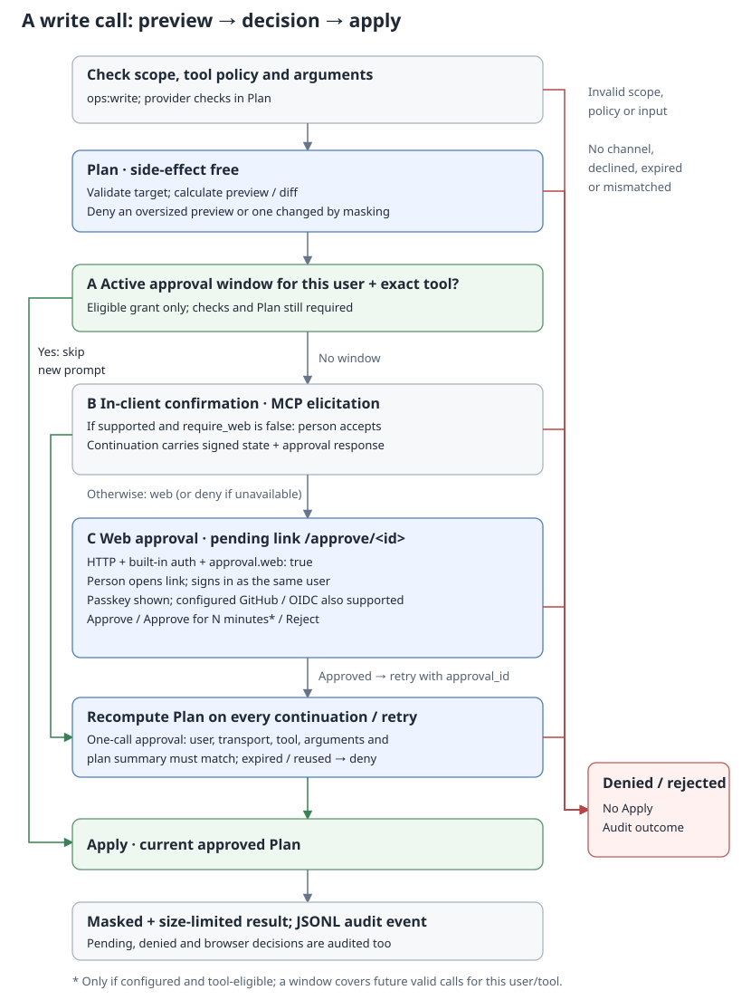

# Human approval

[한국어](ko/approval.md)



Tools registered through the write wrapper need a successful plan and human confirmation before Apply. This includes Kubernetes writes, note writes and `dev_task_start`. Stopping a coding task with `dev_task_cancel` deliberately needs no approval.

## Execution flow

```text
call
  -> check raw argument size and compute argument hash
  -> authenticate caller -> user tool policy -> required scope
  -> reject invalid arguments
  -> Plan: validate target/policy and calculate the change
  -> reject an oversized or masked preview
  -> confirmation: active window / client input / web link
  -> Apply the current approved Plan
  -> mask and limit result -> JSONL audit event
```

The raw size check and argument parsing happen before authorization, but their error is returned after caller, user tool and scope checks. The usual scope is `ops:write`; `dev_task_start` requires `dev:run`. HTTP also requires `ops:read` at `/mcp`.

Plan is side-effect-free. Its summary must identify the target and effect. If masking changes the summary, the write is denied because the human cannot see an unambiguous preview. Each retry computes Plan again. Plan and Apply have separate `server.tool_timeout` deadlines; the default is 30 seconds each.

## Confirmation channels

The manager first validates the request and `require_web` restrictions, then checks for an active approval window. Without a window, it processes supplied client input or `approval_id`; a fresh HTTP request uses web approval by default when `approval.web` is enabled. Explicit `approval.require_web: false` opts in to elicitation when supported, with web approval as fallback. No available channel means denial.

Plans with truncated previews require web approval showing the complete masked arguments; without a browser channel, split the change into smaller writes. This full-review requirement is bound to signed client state and web approval records, while existing eligible approval windows continue to apply.

When full review is required, any redaction change to the arguments (excluding `approval_id`) denies the write before confirmation or approval-window reuse; split the change or remove the masked value.

When a server reaches several systems, such as multiple Kubernetes clusters, approval screens show the target above the summary. Targets marked protected require human approval for every call, even when the tool is eligible for a window.

### Approval window

A window is an optional grant keyed by **user, exact tool name and target**. It covers any valid arguments for that tool on that target, across transports with the same user identity. A grant for one target never covers another target or an unnamed target. It still requires all normal authorization checks and a valid Plan with a visible summary.

`approval.window` is zero by default, disabling grants. If enabled, it must be between `1m` and `12h`, and the tool must match a `path.Match` glob in `approval.window_tools`. An empty list permits no grants. The human must explicitly choose the window option; enabling configuration alone does not grant a window.

There are at most 100 live user/tool/target grants. A new grant does not evict another live grant; renewing an existing grant is allowed. Keep `dev_task_start` out of this list: the code permits it, but a window would approve different coding prompts and projects without another confirmation.

This is a configuration fragment to merge into a working configuration:

```yaml
approval:
  ttl: 10m
  window: 15m
  window_tools: [k8s_rollout_restart]
```

### In-client elicitation

On HTTP with web approval enabled, set `approval.require_web: false` explicitly to opt in to elicitation. Without a web channel, including external/static auth and stdio, elicitation remains the default.

When `require_web` is false and the client advertises elicitation, opsgate returns MCP multi round-trip `InputRequests` with an `opsgate_approval` form. It shows the target when present, summary, requester and transport. The human must accept with `approve: true`. Eligible tools also offer `allow_window`.

The server gives the client HMAC-SHA256 signed request state containing user, transport, tool, target, per-call approval requirement, argument hash, summary hash, expiry, nonce and any offered window duration. The signing key is random for each process start.

On continuation, the server checks the signature and expiry, rejects a reused nonce, then consumes the authenticated nonce **before** checking bindings and the response. A bad binding or response therefore cannot reuse that state. Only `approve` and `allow_window` content keys are accepted. `allow_window` must be a boolean and must correspond to the offered, still-eligible window.

This opt-in lets a compromised client approve its own writes: the server cannot tell whether a human or client software answered. HTTP startup warns when elicitation is allowed. Keep web-only approval when the decision must happen in the authenticated browser.

### Web approval

Web approval requires HTTP with `auth.mode: builtin` and `approval.web: true`. It uses the built-in sign-in session; it is unavailable in external/static modes and stdio.

```text
initial call -> pending result with /approve/<id> link
  -> human opens link and signs in as the requesting user
  -> Reject / Approve / Approve + allow for configured duration
  -> client retries original tool arguments plus approval_id
  -> Plan recomputed -> binding checked -> Apply
```

The initial call returns a text tool result with a link, an expiry and instructions to retry. It is audited as `pending`; it is not a protocol error and does not execute Apply. After approving, return to the client and request the retry. For example, a retry may contain:

```json
{"kind":"deployment","namespace":"default","name":"web","approval_id":"<id from the pending result>"}
```

The page displays the plan line by line, highlights diff lines, and includes masked arguments. Only the exact requesting user can view or decide it. Decisions are protected by CSRF checks and cross-origin protection, are accepted once, and use a strict script-free Content Security Policy.

The retry must match user, transport, tool, target, per-call approval requirement, canonical unredacted argument hash (excluding `approval_id`) and the newly calculated summary. A one-call approval is marked used before Apply, so an Apply failure requires a new approval. An active window is checked earlier and deliberately does not impose this one-call binding.

Web-only decisions are the default when `approval.web` is enabled, either explicitly or by a mode with builtin auth. This fragment makes that choice explicit in a working built-in HTTP configuration:

```yaml
approval:
  ttl: 10m
  web: true
  require_web: true
```

`require_web: true` disables in-client elicitation. An explicit `true` also denies stdio writes through the approval wrapper. When the file omits `require_web`, `-transport stdio` keeps elicitation allowed, including with a mode-based file, because the user starts the process locally and stdio has no web channel. `config show` prints the HTTP default as explicit `true`; running that output on stdio denies writes until the key is removed or set to `false`. Existing eligible windows still work for HTTP calls. HTTP startup rejects `require_web: true` without `web: true`, and rejects web approval unless authentication is built-in.

## Replay protection, limits and state

| Control | Behavior |
| --- | --- |
| Argument binding | SHA-256 of canonical unredacted JSON arguments, excluding `approval_id`; masked arguments are only for display/audit |
| Plan binding | Recomputed summary, target and per-call approval requirement must match; note writes also check the planned file snapshot during Apply |
| One-call use | Web records have a used flag; elicitation uses consumed nonces |
| Pending/input lifetime | `approval.ttl`, default `10m`; a nonpositive TTL causes confirmation requests to be denied |
| Web record capacity | 100 live records, including decided records awaiting consumption; expiry releases capacity |
| Nonce capacity | 1,000 live consumed nonces; live entries are not evicted to accept another continuation |
| Window capacity | 100 live user/tool/target combinations |
| Persistence | Pending records, windows, consumed nonces and signing key are memory-only; restart discards all of them |

The default raw write argument limit is 16 KiB; some content-bearing tools raise it. Summary limits scale with each tool's argument limit. See [Tools](tools.md) for limits.

## Audit and operational boundaries

Tool events use `pending`, `denied`, `ok` or `error`. Browser decisions add `approved` or `rejected` events. Grant creation adds `window_granted`. The `approval` field identifies `elicitation`, `web` or `window` where applicable. Plans and display arguments are masked; full successful results are not stored as audit text.

Approval confirms a requested action, not arbitrary future actions by the same client. Windows intentionally broaden that promise to a tool on the approved target for their lifetime. OS permissions, Kubernetes RBAC, provider allowlists, scopes and tool restrictions remain necessary. Coding agents can run further commands under the runner account after task-start approval; see [Development tools](dev.md).

See [Authentication](authentication.md) to configure built-in sign-in and the [security policy](../SECURITY.md) for trust boundaries.
