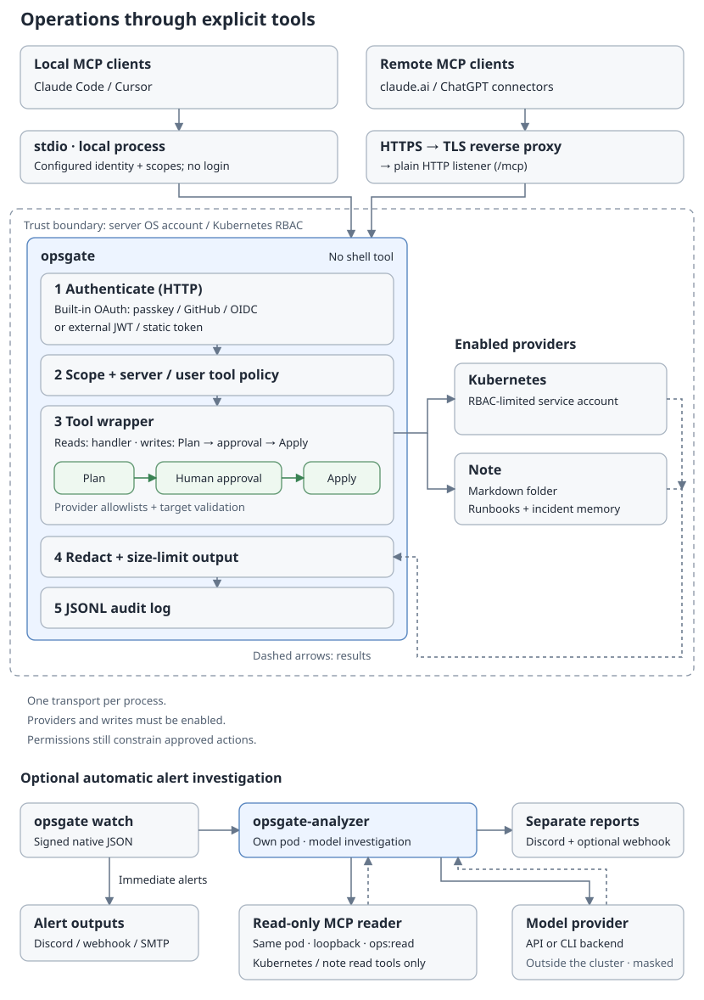

# Architecture

[한국어](ko/architecture.md)



opsgate is a Go MCP server. It exposes configured operations through providers and applies shared authorization, output handling and auditing around their tools.

## Request flow

```text
AI client (claude.ai, ChatGPT, Claude Code, or another MCP client)
  |
  +-- HTTPS -> reverse proxy -> HTTP listener
  |     common security headers, panic recovery, access logging
  |     -> Host check (421 on mismatch) -> endpoint-specific CORS -> routing
  |          /mcp -> Bearer verification -> ops:read -> protocol handler
  |          /.well-known/* -> discovery metadata
  |          /oauth/*, /passkey/*, /admin/clients -> built-in OAuth
  |          /approve/* -> web approval manager
  |          /healthz -> health response
  |
  +-- stdio -> configured local identity and scopes
                  |
                  v
             Go MCP SDK server: tools/list, tools/call
                  |
             shared tool wrapper
                  |
                  +----------+------------+
                  |          |            |
                 kube       note         dev
                                          |
                                      Unix socket
                                          |
                                      dev-runner
                                          |
                                 Git worktree + agent
```

The HTTP listener serves plain HTTP; use a reverse proxy for public HTTPS. `http.public_url` must be an HTTPS origin, except for loopback HTTP. The Host check accepts the configured public authority, or a loopback host when the listener and local connection address are loopback. CORS applies only to discovery and selected MCP/OAuth endpoints, not to browser decision pages.

For `/mcp`, `Mcp-Protocol-Version` values lexically at or above `2026-07-28` select the stateless handler. Earlier or absent values select the session handler, whose session timeout is 30 minutes. This supports newer sessionless clients, including ChatGPT, while keeping sessions for older clients and elicitation. This routing decision does not grant access.

The command selects one transport per process. stdio is the default. HTTP requires an explicit authentication mode and `ops:read` even for callers using `dev:run` tools.

## Packages

| Package | Responsibility |
| --- | --- |
| `cmd/opsgate` | Loads configuration and assembles the process; supports `init`, `config show`, `-gen-token`, `passkey invite`, `watch` and `dev-runner` |
| `internal/config` | Loads one YAML document over defaults, rejects unknown keys, validates configuration and defines scopes |
| `internal/httpserver` | HTTP routing, Host/CORS checks, security headers, access logs and protocol selection |
| `internal/authn` | Static bearer verification and external JWT verification through discovered JWKS |
| `internal/oauth` | Built-in OAuth authorization server: client registration (DCR), S256 PKCE, consent screens, token rotation/revocation, passkeys and administrator client review |
| `internal/server` | Creates the MCP server and registers enabled providers |
| `internal/tool` | Registration policy, caller/tool scopes, argument limits, timeouts, write planning/approval, output masking and truncation, audit events |
| `internal/approval` | In-client elicitation, web approval links and optional approval windows |
| `internal/redact` | Masks known secret patterns using regular expressions and direct scanning; masking is a safety net, not complete secret detection |
| `internal/audit` | Appends JSONL audit events to a file or stderr |
| `internal/ui` | Shared page layout for consent, approval, passkeys and administration |
| `internal/provider/kube` | Kubernetes objects, events and logs; allowlisted rollout restarts, scaling and pod deletion within namespace policy |
| `internal/provider/note` | Searches and reads a Markdown vault; optional create/append/replace/trash tools with content/diff previews and snapshot checks |
| `internal/provider/dev`, `internal/devrunner` | Sends requests to a separate runner; the runner chooses configured projects/agents and executes tasks in Git worktrees |

## Tool execution

Server tool policy is applied during registration. Denied tools do not appear in `tools/list`. Empty `server.tools.allow` permits all offered tools, and deny patterns win. A server policy pattern matching no offered tool causes startup to fail. A caller's optional `tools` globs further restrict calls; they do not filter the shared tool inventory.

```text
Read/general tool:
  argument size -> caller -> user tool policy -> required scope
  -> timed handler -> output handling -> audit -> MCP result

Approved write tool (AddWrite):
  parse/size/hash arguments -> caller -> user tool policy -> required scope
  -> timed Plan -> validate preview -> confirmation -> timed Apply
  -> output handling -> audit -> MCP result
```

Most tools require `ops:read`; approved writes normally require `ops:write`. Dev tools require `dev:run`, and `dev_task_start` uses the approval wrapper with that scope. `dev_task_cancel` is a state-changing general tool and deliberately needs no human approval to stop a task.

The default argument limit is 16 KiB. Content-bearing writes can use larger per-tool limits. The default timeout is 30 seconds and uses context cancellation; writes receive separate Plan and Apply deadlines. Confirmation sits between those deadlines. See [Tools](tools.md) for individual limits.

Tool output and error text over 4 MiB are replaced with an omission message. Otherwise, known secrets are masked before truncation to `server.max_output_bytes` (64 KiB by default). Audit events record identity, transport, tool, masked arguments, outcome, duration and output size; approved writes also record the plan and confirmation method. Full successful output is not stored in the audit event. An empty `server.audit_log` sends JSONL events to stderr, alongside process logs.

## Permission boundaries

Access is constrained by several independent layers: token/local scopes, server tool policy, caller tool restrictions, provider allowlists, and finally OS permissions or Kubernetes RBAC. Provider checks happen inside handlers or plans; approval does not replace them.

Approved writes follow Plan → confirmation → Apply. A one-call confirmation binds the user, transport, tool, unredacted argument hash and plan summary. An optional approval window deliberately grants broader access for one user, tool and target. See [Human approval](approval.md).

Treat logs, notes, events and agent output as untrusted data. Masking reduces accidental exposure; it does not prevent prompt injection or make that text safe to follow as instructions.

Run `dev-runner` under a separate account with its own configuration, projects and agent commands. The server communicates over a Unix socket. On Linux, the runner checks peer credentials with `SO_PEERCRED`, accepting its own UID or callers in the configured socket group. Agent execution is limited by the runner account and any configured agent sandbox, not by the requesting person's OS permissions. See [Development tools](dev.md) and the [security policy](../SECURITY.md).

## Minimal local configuration

All providers are disabled by default. Enabling a provider is separate from enabling writes or granting write scopes. Some policies are permissive when empty, notably server tool allow policy; “everything is off” describes provider defaults, not every setting.

```yaml
stdio:
  user: alice
  scopes: [ops:read]
providers:
  kubernetes:
    enabled: true
    namespaces: [default]
```

Save as `opsgate.yaml`, then run:

```sh
opsgate -config opsgate.yaml -transport stdio
```

See [Configuration](configuration.md), [Authentication](authentication.md) and [Deployment](deploy.md) for the corresponding operator settings.
