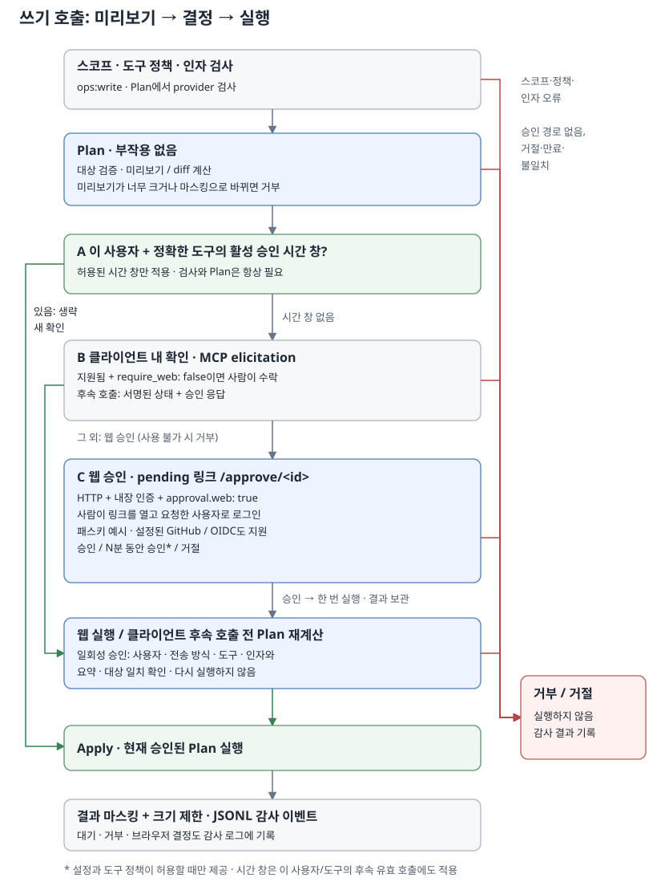

# 사람의 승인

[English](../approval.md)



쓰기 래퍼로 등록한 도구는 계획(Plan)이 성공하고 사람이 승인해야 실행(Apply) 단계로 넘어갑니다. Kubernetes 쓰기, 노트 쓰기, `dev_task_start`가 이 절차를 따릅니다. 코딩 작업을 중지하는 `dev_task_cancel`은 승인 없이 실행할 수 있도록 설계했습니다.

## 실행 흐름

```text
호출
  -> 원본 인자 크기 검사와 인자 해시 계산
  -> 호출자 인증 -> 사용자 도구 정책 -> 필수 스코프
  -> 잘못된 인자 거부
  -> Plan: 대상/정책 검증과 변경 계산
  -> 너무 크거나 마스킹된 미리보기 거부
  -> 승인: 활성 시간 창 / 클라이언트 입력 / 웹 링크
  -> 현재 승인된 Plan으로 Apply
  -> 결과 마스킹 및 크기 제한 -> JSONL 감사 이벤트
```

원본 인자의 크기 검사와 파싱은 인가 전에 처리하지만, 이 과정에서 발생한 오류는 호출자, 사용자 도구 정책, 스코프 검사를 마친 뒤 반환합니다. 일반적으로 필요한 스코프는 `ops:write`이며, `dev_task_start`에는 `dev:run`이 필요합니다. HTTP에서는 `/mcp`에 접근할 때 `ops:read`도 필요합니다.

계획(Plan)은 실제 상태를 바꾸지 않으며, 요약에는 대상과 변경 결과가 명확히 드러나야 합니다. 마스킹으로 요약이 바뀌면 사람이 변경 내용을 정확히 확인할 수 없으므로 쓰기를 거부합니다. 재호출할 때마다 계획을 다시 계산합니다. 계획(Plan)과 실행(Apply)에는 `server.tool_timeout` 제한 시간을 각각 따로 적용하며, 기본값은 각각 30초입니다.

## 승인 경로

opsgate는 먼저 요청과 `require_web` 제한을 검증한 뒤 유효한 승인 시간 창이 있는지 확인합니다. 시간 창이 없으면 전달받은 클라이언트 입력이나 `approval_id`를 처리합니다. 새 HTTP 요청은 `approval.web`이 켜져 있으면 기본적으로 웹 승인을 사용합니다. `approval.require_web: false`를 명시하면 지원하는 클라이언트에서 클라이언트 내 확인(elicitation)을 허용하고, 지원하지 않으면 웹 승인을 사용합니다. 사용할 수 있는 승인 경로가 없으면 요청을 거부합니다.

미리보기가 잘린 계획은 마스킹된 전체 인자를 보여 주는 웹 승인이 필요하며, 브라우저 승인 경로가 없으면 변경을 더 작은 쓰기로 나누어야 합니다. 이 전체 검토 요구 여부는 서명된 클라이언트 상태와 웹 승인 기록에 바인딩되며, 기존의 유효한 승인 시간 창은 계속 적용됩니다.

전체 검토가 필요한 경우 인자(`approval_id` 제외)가 마스킹으로 바뀌면 승인이나 승인 시간 창 재사용 전에 쓰기를 거부하므로, 변경을 나누거나 마스킹된 값을 제거하세요.

서버 하나에서 여러 Kubernetes 클러스터처럼 여러 시스템에 접근하는 경우, 승인 화면은 요약 위에 대상 시스템을 표시합니다. 보호 대상으로 지정된 시스템은 도구에 승인 시간 창을 허용했더라도 호출할 때마다 사람이 승인해야 합니다.

### 승인 시간 창

승인 시간 창은 **사용자, 정확한 도구 이름, 대상 시스템**을 기준으로 일정 시간 동안 승인을 유지하는 선택 기능입니다. 해당 대상에서 그 도구의 유효한 모든 인자에 적용되며, 사용자 ID가 같으면 전송 방식이 달라도 사용할 수 있습니다. 한 대상에 대한 승인은 다른 대상이나 대상 이름이 없는 요청에는 적용되지 않습니다. 일반 인가 검사는 그대로 거쳐야 하고, 내용을 확인할 수 있는 요약과 유효한 계획(Plan)도 필요합니다.

`approval.window`의 기본값은 0이며, 이때는 승인 시간 창을 사용할 수 없습니다. 활성화하려면 값을 `1m`부터 `12h` 사이로 설정해야 하고, 도구 이름이 `approval.window_tools`의 `path.Match` 글로브 패턴과 일치해야 합니다. 목록이 비어 있으면 어떤 도구에도 승인 시간 창을 허용하지 않습니다. 설정을 켜더라도 사람이 승인 시간 창 옵션을 직접 선택해야 승인이 유지됩니다.

유효한 승인 시간 창은 사용자/도구/대상 조합을 기준으로 총 100개까지 유지하며, 새 승인을 추가하려고 기존의 유효한 승인을 삭제하지는 않습니다. 사용자, 도구, 대상이 모두 같으면 승인을 갱신할 수는 있습니다. `dev_task_start`는 이 목록에 넣지 마세요. 코드에서는 허용하지만, 승인 시간 창이 있으면 다른 코딩 프롬프트와 프로젝트도 추가 확인 없이 승인됩니다.

아래 내용을 기존 설정에 추가하세요.

```yaml
approval:
  ttl: 10m
  window: 15m
  window_tools: [k8s_rollout_restart]
```

### 클라이언트 내 확인

웹 승인을 켠 HTTP 서버에서 클라이언트 내 확인을 허용하려면 `approval.require_web: false`를 명시하세요. 웹 채널이 없는 external/static 인증과 stdio에서는 클라이언트 내 확인이 계속 기본값입니다.

`require_web`이 false이고 클라이언트가 elicitation을 지원한다고 알리면, opsgate는 여러 차례 입력을 주고받는 MCP `InputRequests`에 `opsgate_approval` 폼을 담아 반환합니다. 폼에는 요약, 요청자, 전송 방식을 보여 주고 대상 시스템이 있으면 함께 표시합니다. 사람이 `approve: true`로 승인해야 합니다. 승인 시간 창을 허용하는 도구에는 `allow_window` 옵션도 표시합니다.

서버는 사용자, 전송 방식, 도구, 대상 시스템, 호출마다 승인이 필요한지 여부, 인자 해시, 요약 해시, 만료 시각, nonce, 제시한 승인 시간 창의 길이를 요청 상태에 담고 HMAC-SHA256으로 서명해 클라이언트에 전달합니다. 서명 키는 프로세스가 시작할 때마다 무작위로 생성합니다.

후속 호출에서 서버는 서명과 만료 여부를 검사하고 이미 사용한 nonce를 거부합니다. 그런 다음 요청 정보의 일치 여부와 응답을 검사하기 **전에** 인증된 nonce를 사용한 것으로 처리합니다. 따라서 요청 정보가 일치하지 않거나 응답이 잘못되어도 그 상태를 다시 쓸 수 없습니다. 응답 내용의 키는 `approve`와 `allow_window`만 허용합니다. `allow_window`는 boolean이어야 하며, 서버가 제시했고 여전히 허용되는 승인 시간 창에만 사용할 수 있습니다.

이 opt-in을 사용하면 침해된 클라이언트가 자기 쓰기를 스스로 승인할 수 있습니다. 서버는 사람과 클라이언트 소프트웨어 중 누가 답했는지 구별할 수 없습니다. HTTP 시작 시 클라이언트 내 확인을 허용하면 경고를 남깁니다. 인증된 브라우저에서 결정해야 한다면 웹 전용 승인을 유지하세요.

### 웹 승인

웹 승인을 사용하려면 HTTP에서 `auth.mode: builtin`과 `approval.web: true`를 설정해야 합니다. 내장 로그인 세션을 사용하므로 external/static 모드와 stdio에서는 사용할 수 없습니다.

```text
최초 호출 -> /approve/<id> 링크가 있는 pending 결과
  -> 사람이 링크를 열고 요청한 사용자로 로그인
  -> Reject / Approve / Approve + 설정된 시간 동안 허용
  -> 클라이언트가 원래 인자에 approval_id를 추가해 재호출
  -> Plan 재계산 -> 바인딩 검사 -> Apply
```

최초 호출은 링크, 만료 시각, 재호출 안내를 담은 텍스트 도구 결과를 반환하고, 감사 로그에는 `pending`으로 기록합니다. 프로토콜 오류는 아니며 실행(Apply) 단계로 넘어가지 않습니다. 승인한 뒤에는 클라이언트로 돌아가 재호출을 요청하세요. 다음은 재호출 예시입니다.

```json
{"kind":"deployment","namespace":"default","name":"web","approval_id":"<id from the pending result>"}
```

페이지에는 계획을 한 줄씩 표시하고 diff 줄을 강조하며, 마스킹된 인자도 함께 보여 줍니다. 요청한 사용자 본인만 페이지를 열고 승인 여부를 결정할 수 있습니다. 승인·거부 요청에는 CSRF 검사와 교차 출처 보호를 적용하고, 결정은 한 번만 받습니다. 페이지에는 스크립트를 허용하지 않는 엄격한 Content Security Policy를 적용합니다.

재호출할 때는 사용자, 전송 방식, 도구, 대상 시스템, 호출마다 승인이 필요한지 여부, 정규화한 마스킹 전 인자 해시(`approval_id` 제외), 새로 계산한 요약이 모두 일치해야 합니다. 일회성 승인은 실행(Apply) 전에 사용한 것으로 표시하므로, 실행이 실패하면 새 승인이 필요합니다. 유효한 승인 시간 창은 그보다 먼저 확인하며, 시간 창에는 일회성 승인에서 요구하는 이 일치 조건을 적용하지 않도록 설계했습니다.

`approval.web`을 직접 켜거나 builtin 인증을 쓰는 모드가 켜면, 기본적으로 브라우저에서만 승인합니다. 내장 인증을 사용하는 기존 HTTP 설정에 이 선택을 명시하려면 아래 내용을 추가하세요.

```yaml
approval:
  ttl: 10m
  web: true
  require_web: true
```

`require_web: true`는 클라이언트 내 확인을 끕니다. 명시적 `true`는 stdio의 승인 래퍼를 사용하는 쓰기도 거부합니다. 파일에서 `require_web`을 생략하면 모드 파일이라도 `-transport stdio`에서는 클라이언트 내 확인을 허용합니다. 사용자가 로컬에서 시작한 프로세스이고 웹 채널이 없기 때문입니다. `config show`는 HTTP 기본값을 명시적 `true`로 출력하므로, 그 출력을 stdio로 실행하면 키를 지우거나 `false`로 바꾸기 전까지 쓰기를 거부합니다. HTTP에서는 기존의 유효한 승인 시간 창을 계속 사용할 수 있습니다. HTTP 서버를 시작할 때 `require_web: true`인데 `web: true`가 아니면 설정을 거부하며, 내장 인증을 사용하지 않는 경우에도 웹 승인을 허용하지 않습니다.

## 재사용 방지, 제한, 상태

| 제어 | 동작 |
| --- | --- |
| 인자 일치 검사 | `approval_id`를 제외하고 정규화한 마스킹 전 JSON 인자의 SHA-256을 비교합니다. 마스킹된 인자는 표시와 감사 로그에만 사용합니다. |
| 계획(Plan) 일치 검사 | 다시 계산한 요약, 대상 시스템, 호출마다 승인이 필요한지 여부가 일치해야 합니다. 노트 쓰기는 실행(Apply) 중 계획 단계의 파일 스냅샷도 검사합니다. |
| 일회성 사용 | 웹 기록에는 사용 여부를 표시하고, 클라이언트 내 확인에는 이미 사용한 nonce를 기록합니다. |
| 대기/입력 유효 기간 | `approval.ttl`이며 기본값은 `10m`입니다. TTL이 0 이하이면 승인 요청을 거부합니다. |
| 웹 기록 용량 | 결정을 마치고 재호출을 기다리는 기록까지 포함해 유효한 기록은 최대 100개입니다. 만료되면 자리가 비워집니다. |
| nonce 용량 | 사용한 nonce 중 아직 만료되지 않은 항목은 최대 1,000개입니다. 새 후속 호출을 받기 위해 유효한 기존 항목을 삭제하지 않습니다. |
| 시간 창 용량 | 유효한 사용자/도구/대상 조합은 최대 100개입니다. |
| 상태 저장 | 대기 기록, 승인 시간 창, 사용한 nonce, 서명 키는 메모리에만 저장하며, 재시작하면 모두 사라집니다. |

원본 쓰기 인자의 기본 크기 제한은 16 KiB이며, 내용을 전달하는 일부 도구는 이보다 큰 인자를 허용합니다. 요약의 크기 제한도 도구별 인자 제한에 따라 커집니다. 각 제한은 [도구](tools.md)를 참고하세요.

## 감사 및 운영 경계

도구 이벤트는 `pending`, `denied`, `ok`, `error`로 기록합니다. 브라우저에서 승인하거나 거부하면 `approved` 또는 `rejected` 이벤트를 추가하고, 승인 시간 창을 허용하면 `window_granted`를 추가합니다. 승인 경로가 있으면 `approval` 필드에 `elicitation`, `web`, `window`를 표시합니다. 계획과 표시용 인자는 마스킹하며, 성공한 호출의 전체 결과는 감사 텍스트로 저장하지 않습니다.

승인은 요청한 작업에만 유효하며, 같은 클라이언트가 이후에 요청하는 임의의 작업까지 허용하지는 않습니다. 승인 시간 창은 유효 기간 동안 승인한 대상에서 그 도구의 모든 작업으로 승인 범위를 넓히도록 설계했습니다. OS 권한, Kubernetes RBAC, provider 허용 목록, 스코프, 도구 제한은 여전히 필요합니다. 코딩 에이전트는 작업 시작 승인을 받은 뒤 runner 계정으로 추가 명령을 실행할 수 있습니다. [개발 도구](dev.md)를 참고하세요.

내장 로그인 설정은 [인증](authentication.md)을, 신뢰 경계는 [보안 정책](security.md)을 참고하세요.
