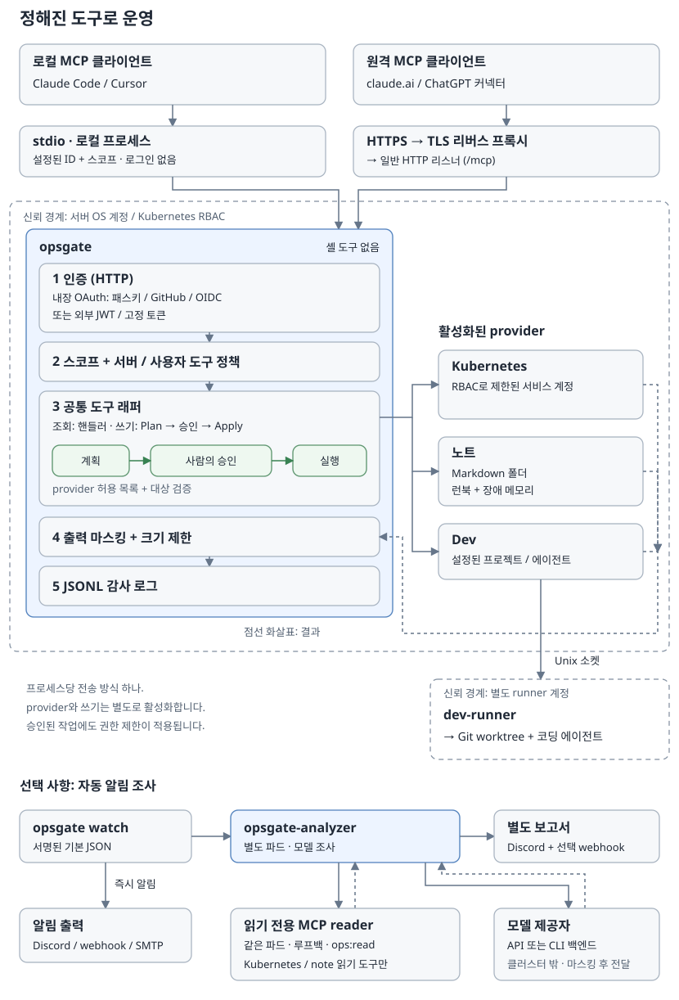

# 아키텍처

[English](../architecture.md)



opsgate는 Go로 작성한 MCP 서버입니다. 설정된 운영 작업을 provider의 도구로 제공하고, 각 도구에 공통 인가, 출력 처리, 감사 기능을 적용합니다.

## 요청 흐름

```text
AI 클라이언트 (claude.ai, ChatGPT, Claude Code 등 MCP 클라이언트)
  |
  +-- HTTPS -> 리버스 프록시 -> HTTP 리스너
  |     공통 보안 헤더, panic 복구, 접근 로그
  |     -> Host 검사 (불일치 시 421) -> 엔드포인트별 CORS -> 라우팅
  |          /mcp -> Bearer 검증 -> ops:read -> 프로토콜 핸들러
  |          /.well-known/* -> 검색 메타데이터
  |          /oauth/*, /passkey/*, /admin/clients -> 내장 OAuth
  |          /approve/* -> 웹 승인
  |          /healthz -> 상태 응답
  |
  +-- stdio -> 설정된 로컬 ID와 스코프
                  |
                  v
             Go MCP SDK 서버: tools/list, tools/call
                  |
             공통 도구 래퍼
                  |
                  +----------+------------+
                  |          |            |
                 kube       note         dev
                                          |
                                      Unix 소켓
                                          |
                                      dev-runner
                                          |
                                 Git worktree + 에이전트
```

HTTP 리스너는 일반 HTTP로 통신하므로, 외부에 HTTPS로 제공하려면 리버스 프록시를 사용하세요. `http.public_url`은 루프백 HTTP를 제외하면 HTTPS origin이어야 합니다. Host 검사에서는 설정된 공개 authority를 허용하며, 리스너와 로컬 연결 주소가 모두 루프백이면 루프백 호스트도 허용합니다. CORS는 검색 및 일부 MCP/OAuth 엔드포인트에만 적용하고, 브라우저에서 승인 여부 등을 결정하는 페이지에는 적용하지 않습니다.

`/mcp`에서는 `Mcp-Protocol-Version` 값을 문자열로 비교해 `2026-07-28` 이상이면 stateless 핸들러를 선택합니다. 그보다 이전 값이거나 헤더가 없으면 세션 핸들러를 사용하며, 세션 제한 시간은 30분입니다. 이렇게 하면 ChatGPT를 비롯한 최신 세션리스 클라이언트를 지원하면서도 이전 클라이언트와 클라이언트 내 확인(elicitation)에 필요한 세션을 유지할 수 있습니다. 이 라우팅 결정만으로 접근 권한을 주지는 않습니다.

프로세스마다 전송 방식을 하나만 선택하며, 기본값은 stdio입니다. HTTP를 사용하려면 인증 모드를 명시해야 하고, `dev:run` 도구를 쓰는 호출자에게도 `ops:read`가 있어야 합니다.

## 패키지

| 패키지 | 역할 |
| --- | --- |
| `cmd/opsgate` | 설정을 읽고 프로세스를 구성하며, `init`, `config show`, `-gen-token`, `passkey invite`, `watch`, `dev-runner`를 지원합니다. |
| `internal/config` | YAML 문서 하나를 읽어 기본값에 덮어쓰고, 알 수 없는 키를 거부하며 설정 검증과 스코프 정의를 담당합니다. |
| `internal/httpserver` | HTTP 라우팅, Host/CORS 검사, 보안 헤더, 접근 로그, 프로토콜 선택을 담당합니다. |
| `internal/authn` | 고정 Bearer 토큰과 외부 JWT를 검증하며, 외부 JWT 검증에는 검색으로 찾은 JWKS를 사용합니다. |
| `internal/oauth` | 내장 OAuth 인가 서버로서 클라이언트 등록(DCR), S256 PKCE, 동의 화면, 토큰 교체/폐기, 패스키, 관리자의 클라이언트 검토를 제공합니다. |
| `internal/server` | MCP 서버를 만들고 활성화된 provider를 등록합니다. |
| `internal/tool` | 등록 정책, 호출자/도구 스코프, 인자 제한, 제한 시간, 쓰기 계획/승인, 출력 마스킹과 자르기, 감사 이벤트를 처리합니다. |
| `internal/approval` | 클라이언트 내 확인과 웹 승인 링크를 제공하며, 필요하면 승인 시간 창도 사용할 수 있습니다. |
| `internal/redact` | 정규식과 직접 스캔으로 알려진 비밀값 패턴을 마스킹하지만, 안전장치일 뿐 모든 비밀값을 찾아내지는 못합니다. |
| `internal/audit` | 파일 또는 stderr에 JSONL 감사 이벤트를 추가합니다. |
| `internal/ui` | 동의, 승인, 패스키, 관리 페이지의 공통 레이아웃을 제공합니다. |
| `internal/provider/kube` | Kubernetes 오브젝트, 이벤트, 로그를 제공하고, 네임스페이스 정책과 허용 목록에 따라 rollout restart, scale, 파드 삭제를 실행합니다. |
| `internal/provider/note` | Markdown 볼트를 검색하고 읽으며, 선택 사항인 create/append/replace/trash 도구에서는 내용/diff 미리보기와 스냅샷 검사를 사용합니다. |
| `internal/provider/dev`, `internal/devrunner` | 별도 runner에 요청을 보내면, runner가 설정된 프로젝트/에이전트를 선택해 Git worktree에서 작업을 실행합니다. |

## 도구 실행

서버 도구 정책은 도구를 등록할 때 적용하며, 거부된 도구는 `tools/list`에 표시하지 않습니다. `server.tools.allow`가 비어 있으면 제공되는 모든 도구를 허용하지만, 거부 패턴이 있으면 그 패턴을 우선 적용합니다. 서버 정책에 제공되는 도구 어느 것과도 일치하지 않는 패턴이 있으면 서버가 시작되지 않습니다. 호출자에게 `tools` 글로브를 설정하면 호출 범위를 더 제한할 수 있지만, 공통 도구 목록을 필터링하지는 않습니다.

```text
읽기/일반 도구:
  인자 크기 -> 호출자 -> 사용자 도구 정책 -> 필수 스코프
  -> 시간 제한 핸들러 -> 출력 처리 -> 감사 -> MCP 결과

승인이 필요한 쓰기 도구 (AddWrite):
  인자 파싱/크기/해시 -> 호출자 -> 사용자 도구 정책 -> 필수 스코프
  -> 시간 제한 Plan -> 미리보기 검증 -> 승인 -> 시간 제한 Apply
  -> 출력 처리 -> 감사 -> MCP 결과
```

대부분의 도구에는 `ops:read`가 필요하고, 승인이 필요한 쓰기에는 보통 `ops:write`가 필요합니다. Dev 도구에는 `dev:run`이 필요하며, `dev_task_start`는 이 스코프로 승인 래퍼를 사용합니다. `dev_task_cancel`은 상태를 바꾸는 일반 도구이지만, 작업을 중지할 때는 의도적으로 사람의 승인을 요구하지 않습니다.

기본 인자 크기 제한은 16 KiB이며, 내용을 전달하는 쓰기 도구에는 개별적으로 더 큰 제한을 적용할 수 있습니다. 기본 제한 시간은 30초이고 context 취소를 사용합니다. 쓰기는 계획(Plan)과 실행(Apply)에 각각 제한 시간을 적용하며, 그 사이에 승인을 받습니다. 도구별 제한은 [도구](tools.md)를 참고하세요.

도구 출력과 오류 텍스트가 4 MiB를 넘으면 생략 메시지로 대체합니다. 그 이하면 알려진 비밀값을 마스킹한 뒤 `server.max_output_bytes`에 맞춰 자르며, 기본값은 64 KiB입니다. 감사 이벤트에는 ID, 전송 방식, 도구, 마스킹한 인자, 결과, 소요 시간, 출력 크기를 기록하고, 승인된 쓰기는 계획과 승인 방식도 함께 기록합니다. 성공한 호출의 전체 출력은 감사 이벤트에 저장하지 않습니다. `server.audit_log`가 비어 있으면 프로세스 로그와 함께 stderr로 JSONL 이벤트를 보냅니다.

## 권한 경계

접근 권한은 여러 계층에서 독립적으로 제한합니다. 토큰/로컬 스코프, 서버 도구 정책, 호출자 도구 제한, provider 허용 목록을 적용하고, 마지막으로 OS 권한이나 Kubernetes RBAC를 적용합니다. provider는 핸들러나 계획 안에서 권한을 검사하며, 승인을 받았더라도 이 검사는 그대로 적용합니다.

승인이 필요한 쓰기는 계획(Plan) → 승인 → 실행(Apply) 순서로 진행합니다. 일회성 승인은 사용자, 전송 방식, 도구, 마스킹 전 인자 해시, 계획 요약에 묶입니다. 승인 시간 창은 선택 사항이며, 사용하면 특정 사용자, 도구, 대상 조합에 의도적으로 더 넓은 접근 권한을 줍니다. [사람의 승인](approval.md)을 참고하세요.

로그, 노트, 이벤트, 에이전트 출력은 신뢰할 수 없는 데이터로 취급하세요. 마스킹은 비밀값이 실수로 드러날 가능성을 줄이지만, 프롬프트 인젝션을 막거나 그 텍스트를 안전하게 따를 수 있는 지시로 만들지는 않습니다.

`dev-runner`는 자체 설정, 프로젝트, 에이전트 명령을 사용하는 별도 계정으로 실행하세요. 서버는 Unix 소켓으로 runner와 통신합니다. Linux에서 runner는 `SO_PEERCRED`로 연결 상대의 자격 증명을 검사하고, 자신과 UID가 같거나 설정된 소켓 그룹에 속한 호출자를 허용합니다. 에이전트가 실행할 수 있는 작업의 범위는 runner 계정과 설정된 에이전트 샌드박스가 결정하며, 요청한 사람의 OS 권한을 따르지는 않습니다. [개발 도구](dev.md)와 [보안 정책](security.md)을 참고하세요.

## 최소 로컬 설정

모든 provider는 기본적으로 꺼져 있으며, provider 활성화, 쓰기 활성화, 쓰기 스코프 설정은 각각 별개입니다. 서버 도구 허용 정책처럼 비어 있으면 폭넓게 허용하는 정책도 있으므로, “모두 꺼짐”은 모든 설정이 아닌 provider의 기본값을 뜻합니다.

```yaml
stdio:
  user: alice
  scopes: [ops:read]
providers:
  kubernetes:
    enabled: true
    namespaces: [default]
```

`opsgate.yaml`로 저장한 뒤 다음 명령을 실행하세요.

```sh
opsgate -config opsgate.yaml -transport stdio
```

운영에 필요한 설정은 [설정](configuration.md), [인증](authentication.md), [배포](deploy.md)를 참고하세요.
